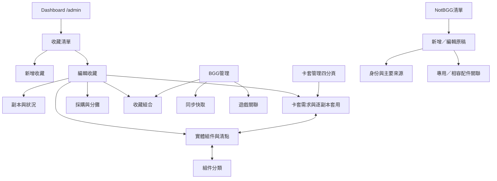

# V2-UI-Review-01 — 管理介面使用者審核準備

2026-11-17 接續：副本計數、卡套不足兩層算法與後續撤銷套用規格已逐項確認，見 [已確認規格與開發驗收清單](V2-Admin-decisions-and-test-plan.md)。下方為 2026-11-12 原始 UI 盤點與截圖，不因局部規則確認而代表整頁布局通過；現況與新規格差異、待核對及測試項目以新清單追蹤，尚未實作或部署。

日期：2026-11-12（Asia/Taipei）。狀態：**審核資料已備妥；畫面設計尚未獲使用者逐頁確認。沒有進行 UI 修改或部署。**

## 審核來源、截圖與安全邊界

- 實際盤點 **16 個 Admin 頁面路由**，另納入同一路由的主要分頁／新增／編輯狀態，共 **23 組桌面／手機對照**及 11 張補充，共 **57 張 JPEG**。先前初估 17 已更正為實際檔案去重後的 16。
- [開啟離線截圖圖庫](V2-UI-Review-01-screenshots/index.html)，或使用已啟動的[本機圖庫](http://127.0.0.1:6309/review-gallery)。下方各頁另有逐張連結；資料來源與量測存於 [capture-manifest.json](V2-UI-Review-01-screenshots/capture-manifest.json)。
- **截圖全部為本機原始 Astro UI＋合成唯讀資料，不是正式網站資料截圖。** 自動化可用的瀏覽器沒有既有正式管理員工作階段，依指令採本機預覽替代，未要求重新登入或重新驗證 Release-03。
- 對照 version 19 的正式建置副本，55 個頁面／元件／Layout／CSS 檔案 SHA-256 相同。這支持 UI 原始碼基準一致；不表示本機服務替身的內容、筆數或行為就是正式資料。
- 預覽工具在專案外，只將原始 UI 編譯供審核；資料查詢以服務替身與合成物件提供，**沒有資料庫、Migration、Wrangler、Cloudflare、BGG API 或正式認證**。分類標籤與資格資料亦只是畫面示例，沒有執行或修改正式分類規則。
- 預覽僅監聽 127.0.0.1:6309，所有非 GET／HEAD 請求回覆 405，外部瀏覽器資源由 CSP 限制。按鈕展示的是既有能力，**本次沒有按下儲存、清點、扣庫存、同步、封存或身份命令**。
- 桌面／手機指 **CSS viewport 1440×900／375×900**。截圖為原始工具輸出，部分 JPEG 因瀏覽器捲軸／工具縮放為 1425 或 360 像素寬，未拉伸修圖；不能把影像編碼尺寸當作 CSS breakpoint。長頁只拍視窗及補充區段，未假稱完整長頁。
- 全頁擷取工具曾出現錯誤重排，已棄用該擷取方式、覆寫錯誤圖像；最終使用固定 viewport，不把擷取器問題當成網站問題。需要像素精準完整 PNG 時，依文末人工補拍步驟。
- 實際查看了代表性桌面、手機、分類表、展開表單與長編輯器底部，並量測所有主畫面的整頁 scrollWidth 未超過 viewport。**這不是重跑歷史測試，也不是業務流程驗收。**
- 沒有 Token、完整 AUD、Secret、正式採購價格／訂單或私人管理備註。示例金額皆為空白或 0，名稱明示合成；未讀取正式備份。

本機預覽：`http://127.0.0.1:6309/admin`。先前連線失敗是本機程序啟動方式造成，已改為背景服務並以本機 200 及實際瀏覽器畫面確認。**不需登入。** 圖庫 index.html 可直接在本機開啟，不依賴預覽服務。

## 路由總覽與逐頁確認狀態

| 編號 | 頁面 | 實際路由／必要參數 | 圖片組 | 設計確認 |
| --- | --- | --- | --- | --- |
| R01 | 管理首頁 Dashboard | /admin | 01 | 待使用者確認 |
| R02 | 收藏清單 | /admin/collection | 02 | 待使用者確認 |
| R03 | 新增收藏 | /admin/collection/new | 03 | 待使用者確認 |
| R04 | 編輯收藏 | /admin/collection/[id] | 04 | 待使用者確認 |
| R05 | 副本、語言、版本與狀況 | /admin/collection/[id]/copies | 05 | 待使用者確認 |
| R06 | 實體組件與清點 | /admin/collection/components/manage?collection=<id> | 06 | 待使用者確認 |
| R07 | 組件分類（唯讀） | /admin/collection/components/classification | 07 | 待使用者確認 |
| R08 | 卡套管理（四個分頁） | /admin/sleeves | 08、09、10、11 | 待使用者確認 |
| R09 | 卡套需求與逐副本套用 | /admin/sleeves/requirements?collection=<id> | 12 | 待使用者確認 |
| R10 | 採購、分攤與成本 | /admin/purchases | 13、14、15 | 待使用者確認 |
| R11 | BGG 同步、遊戲關聯、收藏組合 | /admin/bgg | 16、17、18 | 待使用者確認 |
| R12 | NotBGG 清單 | /admin/notbgg | 19 | 待使用者確認 |
| R13 | 新增 NotBGG | /admin/notbgg/new | 20 | 待使用者確認 |
| R14 | 編輯 NotBGG 與修訂歷史 | /admin/notbgg/[id] | 21 | 待使用者確認 |
| R15 | NotBGG 身份對應與主要來源 | /admin/notbgg/[id]/link | 22 | 待使用者確認 |
| R16 | NotBGG 專用／相容配件關聯 | /admin/notbgg/[id]/relations | 23 | 待使用者確認 |

**不存在獨立的 /admin/collection/components 頁面**；應使用 /manage 或 /classification。/api/admin/auth-check 為 API，不列為管理 UI 頁面。英文沿用 ?lang=en，不是另一套 /en/admin 路由。

## 目前導航關係

共用 AdminLayout 的八個入口為：Dashboard、收藏、實體組件、分類、卡套、採購、BGG 與關聯、NotBGG。桌面左側，375px 改為頂部多列連結；不是抽屜式手機選單。

以下流程僅依現有程式與可見 UI 整理，沒有在正式資料上實際提交。

## R01 — 管理首頁 Dashboard

- **路由**：`/admin`。來源：`src/pages/admin/index.astro`。
- **目前布局**：桌面為側欄＋兩欄四卡；手機為上方換行導覽＋單欄卡片。
- **主要功能與欄位**：收藏項目、已收藏、願望清單、預購；卡套尺寸與需求紀錄；組件定義筆數；BGG／NotBGG 筆數及封存提示。
- **按鈕／入口**：返回公開網站、收藏管理、卡套管理、組件管理、NotBGG 管理；「BGG 管理（待開發）」目前停用。
- **操作流程**：由概況卡或共用側欄進入各管理清單。組件卡的「組件管理」實際前往唯讀分類頁。
- **待使用者確認**：BGG 已有功能，首頁仍顯示待開發是否造成誤導？組件卡入口應與側欄「實體組件」或「組件分類」哪個使用意圖對齊？目前卡片是否涵蓋你最常用的入口？

畫面 01-dashboard：[1440px](V2-UI-Review-01-screenshots/01-dashboard-1440.jpg) ／ [375px](V2-UI-Review-01-screenshots/01-dashboard-375.jpg)

確認結果：□ 保留　□ 調整（請指定欄位／區域）　□ 需補看資料狀態。

## R02 — 收藏清單

- **路由**：`/admin/collection`。來源：`src/components/CollectionAdmin.astro`。
- **目前布局**：標題與新增入口、資料範圍、搜尋／多個篩選、分組紀錄及前後頁。桌面篩選多欄，手機縱向排列。
- **主要功能與欄位**：production／test、名稱或身份搜尋、分組／逐筆、BGG／NotBGG／缺少來源、收藏狀態、願望旗標、封存狀態；紀錄顯示 ID、名稱、類型與狀態。
- **按鈕／入口**：新增收藏、搜尋、展開遊戲分組、逐筆編輯、上一頁／下一頁；發生衝突或錯誤時重新載入。
- **操作流程**：選範圍與篩選 → 搜尋 → 展開分組 → 選收藏編輯；或新增收藏。分組不是同一筆收藏，也不會合併副本。
- **待使用者確認**：分組是否應維持預設？手機搜尋條件是否過多？production／test 與英文狀態代碼是否容易理解？

畫面 02-collection-list：[1440px](V2-UI-Review-01-screenshots/02-collection-list-1440.jpg) ／ [375px](V2-UI-Review-01-screenshots/02-collection-list-375.jpg)

確認結果：□ 保留　□ 調整（請指定欄位／區域）　□ 需補看資料狀態。

## R03 — 新增收藏

- **路由**：`/admin/collection/new`。來源：`src/components/CollectionAdmin.astro`。
- **目前布局**：返回列表、資料範圍、遊戲搜尋選擇區、主表單與備註。桌面雙欄欄位，手機長單欄。
- **主要功能與欄位**：選擇既有遊戲；收藏名稱、個人評分、遊玩次數、語言、版本、購買日期、價格（最小貨幣單位）、幣別、來源、收藏狀態、願望清單、是否建立副本、個人評論、卡套／收納／配件備註。
- **按鈕／入口**：搜尋既有遊戲、選擇結果、儲存收藏、返回列表；原始資料摘要可展開。
- **操作流程**：選資料範圍 → 搜尋並選既有遊戲 → 填收藏欄位 → 決定是否建立副本 → 儲存後轉入編輯頁。本次只觀察，不儲存。
- **待使用者確認**：先選遊戲再填表的順序是否清楚？價格以「分」輸入是否容易誤解？建立副本勾選預設與購買欄位是否符合你的操作習慣？

畫面 03-collection-new：[1440px](V2-UI-Review-01-screenshots/03-collection-new-1440.jpg) ／ [375px](V2-UI-Review-01-screenshots/03-collection-new-375.jpg)

確認結果：□ 保留　□ 調整（請指定欄位／區域）　□ 需補看資料狀態。

## R04 — 編輯收藏

- **路由**：`/admin/collection/[id]`。來源：`src/components/CollectionAdmin.astro`。
- **目前布局**：頁首先排列收藏組合、採購、卡套需求等入口，接返回列表、組件與副本連結，再開始資料表單。手機到第一個欄位前需較長捲動。
- **主要功能與欄位**：沿用新增欄位；另顯示 Collection ID、game_id、Revision、封存／來源狀態與副本／採購／卡套 JSON 摘要。
- **按鈕／入口**：儲存、封存、重新載入；管理收藏組合、採購、卡套需求、實體組件、副本。既有受控副本會限制建立勾選的狀態。
- **操作流程**：由清單進入 → 修改收藏 → 儲存；副本、清點、採購、卡套等透過連結分別管理。封存需確認，不能當作刪除。
- **待使用者確認**：頁首多個入口的優先順序是否合適？技術欄位與 JSON 摘要是否需要直接出現在日常編輯頁？歷史購買提示與新採購成本的差異是否清楚？

畫面 04-collection-edit：[1440px](V2-UI-Review-01-screenshots/04-collection-edit-1440.jpg) ／ [375px](V2-UI-Review-01-screenshots/04-collection-edit-375.jpg)

確認結果：□ 保留　□ 調整（請指定欄位／區域）　□ 需補看資料狀態。

## R05 — 副本、語言、版本與狀況

- **路由**：`/admin/collection/[id]/copies`。來源：`src/pages/admin/collection/[id]/copies.astro`。
- **目前布局**：返回收藏／實體組件、標題、收藏識別、新增副本摺疊區，接每副本紀錄及狀況摺疊表單。
- **主要功能與欄位**：副本標籤、語言、版本；封膜、檢查狀態、取得品況、檢查日期、狀況標籤、缺件／損壞私人說明。
- **按鈕／入口**：新增副本、儲存副本、展開狀況、儲存副本狀況、第一頁／下一頁。
- **操作流程**：從收藏編輯進入 → 選副本 → 改語言／版本，或展開狀況 → 分別儲存；不會自動修改組件清點。
- **待使用者確認**：副本基本資料與狀況兩個儲存入口是否清楚？「取得品況」與「目前狀況」能否區分？折疊的狀況區是否容易被忽略？

畫面 05-copies：[1440px](V2-UI-Review-01-screenshots/05-copies-1440.jpg) ／ [375px](V2-UI-Review-01-screenshots/05-copies-375.jpg)

確認結果：□ 保留　□ 調整（請指定欄位／區域）　□ 需補看資料狀態。

## R06 — 實體組件與清點

- **路由**：`/admin/collection/components/manage?collection=<id>`。來源：`src/pages/admin/collection/components/manage.astro`。
- **目前布局**：收藏 ID 開啟器、收藏標題、新增組件表單、逐組件卡片。卡片內含資格標籤、編輯摺疊、清點及需求指派表單。
- **主要功能與欄位**：組件名稱、類型、預期數量、單位、歸屬確認；每個副本的實際數量；未指派卡套需求。類型／單位依既有 Schema 選項，不新增語意。
- **按鈕／入口**：開啟收藏、新增、編輯／儲存組件、儲存清點、關聯需求、返回收藏、組件分類。
- **操作流程**：從收藏連結帶入 ID，或手輸 ID → 檢視分類 → 合格組件才顯示編輯／清點；已確認 card 才有卡套指派。來源不完整不能寫入。
- **待使用者確認**：手輸收藏 ID 的入口是否適合日常使用？同一張卡內混合組件編輯、逐副本清點與需求指派是否容易辨認？預期／實際數量的視覺區別是否足夠？

畫面 06-physical：[1440px](V2-UI-Review-01-screenshots/06-physical-1440.jpg) ／ [375px](V2-UI-Review-01-screenshots/06-physical-375.jpg)

確認結果：□ 保留　□ 調整（請指定欄位／區域）　□ 需補看資料狀態。

## R07 — 組件分類（唯讀）

- **路由**：`/admin/collection/components/classification`。來源：`src/pages/admin/collection/components/classification.astro`。
- **目前布局**：標題與互連入口、證據警告、八欄表格、游標分頁。桌面可見大部分欄位；手機使用局部橫向捲動。
- **主要功能與欄位**：定義 ID、所屬收藏、組件名稱、原 component_type、分類、原因、證據完整性、衝突資訊。
- **按鈕／入口**：收藏管理、管理實體組件、每列收藏連結、第一頁／下一頁；本頁無新增、編輯或刪除。
- **操作流程**：由側欄或 Dashboard 進入 → 查分類與原因 → 點收藏進組件管理。
- **待使用者確認**：手機先看到 ID／名稱，分類結果需向右捲動，是否符合你的閱讀優先順序？原因與衝突是否需要展開式閱讀？目前頁面沒有分類篩選控制，是否需要列為後續需求？

畫面 07-classification：[1440px](V2-UI-Review-01-screenshots/07-classification-1440.jpg) ／ [375px](V2-UI-Review-01-screenshots/07-classification-375.jpg)

確認結果：□ 保留　□ 調整（請指定欄位／區域）　□ 需補看資料狀態。

## R08 — 卡套管理（四個分頁）

- **路由**：`/admin/sleeves`。來源：`src/pages/admin/sleeves/index.astro`。
- **目前布局**：標題、需求管理入口、四個分頁、篩選、新增產品摺疊、產品／尺寸／需求／交易紀錄。桌面表單雙欄，手機單欄。
- **主要功能與欄位**：產品：品牌、名稱、寬高 mm、每包張數、厚度、備註、啟用；篩選使用尺寸／產品 ID。庫存：期初／進貨、使用、帳面餘額。交易：操作、包／張數量、日期、原因。需求：收藏／組件資格與引用。
- **按鈕／入口**：篩選、新增／儲存產品、停用、查看交易、登錄庫存變更、需求與逐副本套用。尺寸與需求查詢未重複提供另一套 CRUD。
- **操作流程**：查產品 → 展開新增／編輯，或展開庫存交易 → 明確登錄；需要遊戲需求／實際套用時進獨立需求頁。查詢與選產品不會扣庫存。
- **待使用者確認**：四個分頁與另一個「需求管理」入口是否容易混淆？尺寸／產品 ID 篩選是否太技術化？交易的包與張切換及停用位置是否夠明確？

畫面 08-sleeve-products：[1440px](V2-UI-Review-01-screenshots/08-sleeve-products-1440.jpg) ／ [375px](V2-UI-Review-01-screenshots/08-sleeve-products-375.jpg)  
畫面 09-sleeve-sizes：[1440px](V2-UI-Review-01-screenshots/09-sleeve-sizes-1440.jpg) ／ [375px](V2-UI-Review-01-screenshots/09-sleeve-sizes-375.jpg)  
畫面 10-sleeve-references：[1440px](V2-UI-Review-01-screenshots/10-sleeve-references-1440.jpg) ／ [375px](V2-UI-Review-01-screenshots/10-sleeve-references-375.jpg)  
畫面 11-sleeve-transactions：[1440px](V2-UI-Review-01-screenshots/11-sleeve-transactions-1440.jpg) ／ [375px](V2-UI-Review-01-screenshots/11-sleeve-transactions-375.jpg)

確認結果：□ 保留　□ 調整（請指定欄位／區域）　□ 需補看資料狀態。

## R09 — 卡套需求與逐副本套用

- **路由**：`/admin/sleeves/requirements?collection=<id>`。來源：`src/pages/admin/sleeves/requirements.astro`。
- **目前布局**：返回入口、收藏 ID 開啟器、規則說明、新增需求摺疊、指派篩選、需求卡及其副本套用區。
- **主要功能與欄位**：尺寸、需求張數、名稱／說明、適用副本、card 組件；每副本進度、產品、實際套用張數、日期、尚未手動扣帳確認。
- **按鈕／入口**：開啟收藏、儲存需求（不扣庫存）、編輯需求、確認套用並扣庫存、返回收藏／組件。
- **操作流程**：選收藏 → 新增未指派或合格 card 需求 → 檢視每副本 → 有資格與清點才選產品及確認扣庫存；有套用的需求被鎖定。
- **待使用者確認**：需求與實際套用的層級是否一眼可分？每副本的未套用／部分／完成顯示是否直覺？鎖定理由、歷史引用與扣庫存警語是否容易讀懂？

畫面 12-sleeve-workflow：[1440px](V2-UI-Review-01-screenshots/12-sleeve-workflow-1440.jpg) ／ [375px](V2-UI-Review-01-screenshots/12-sleeve-workflow-375.jpg)

確認結果：□ 保留　□ 調整（請指定欄位／區域）　□ 需補看資料狀態。

## R10 — 採購、分攤與成本

- **路由**：`/admin/purchases`。來源：`src/pages/admin/purchases/index.astro`。
- **目前布局**：同一路由以 ?new=1／?id=<id> 顯示新增／編輯；表單之後仍有篩選、分幣別總額、收藏成本及清單。手機表單較長。
- **主要功能與欄位**：日期、來源、訂單編號、幣別、狀態、運費、稅費、其他費用、折扣、退款、分攤方式、私人備註；明細收藏 ID、說明、數量、單價、折扣及分攤額；查詢年份／商店／收藏。
- **按鈕／入口**：新增採購、採購清單、增加明細、移除此新增明細、儲存採購與分攤、篩選、第一頁／下一頁。歷史或外部引用訂單為唯讀。
- **操作流程**：新增／選訂單 → 填明細與共同費用 → 選直接、手動或比例分攤 → 檢視計算 → 儲存；不建立副本，不混加不同幣別或歷史價格。
- **待使用者確認**：新增／編輯與清單共頁是否方便？所有金額以最小貨幣單位輸入是否容易誤填？表單儲存按鈕與成本摘要距離是否合適？

畫面 13-purchases：[1440px](V2-UI-Review-01-screenshots/13-purchases-1440.jpg) ／ [375px](V2-UI-Review-01-screenshots/13-purchases-375.jpg)  
畫面 14-purchase-new：[1440px](V2-UI-Review-01-screenshots/14-purchase-new-1440.jpg) ／ [375px](V2-UI-Review-01-screenshots/14-purchase-new-375.jpg)  
畫面 15-purchase-edit：[1440px](V2-UI-Review-01-screenshots/15-purchase-edit-1440.jpg) ／ [375px](V2-UI-Review-01-screenshots/15-purchase-edit-375.jpg)

確認結果：□ 保留　□ 調整（請指定欄位／區域）　□ 需補看資料狀態。

## R11 — BGG 同步、遊戲關聯、收藏組合

- **路由**：`/admin/bgg`。來源：`src/pages/admin/bgg/index.astro`。
- **目前布局**：三個分頁：快取、遊戲關聯、收藏組合。快取有同步輸入、查詢、批次按鈕與逐筆卡；關聯有說明、新增摺疊、篩選及紀錄。
- **主要功能與欄位**：同步 ID（最多 3）、名稱／ID 搜尋、狀態、最後成功／嘗試時間、錯誤與原始證據；關聯來源／目標、類型、公開確認、私人備註。
- **按鈕／入口**：同步指定 ID、同步所選、單筆同步／重試、搜尋；新增／儲存／封存關聯，第一頁／下一頁。
- **操作流程**：查詢與同步分開；同步會呼叫外部 API，審核不可點擊。關聯先選 game 或 collection domain，再輸入已登記身份及方向，不連動建立收藏或成本。
- **待使用者確認**：查詢按鈕與同步寫入操作是否區分清楚？同頁集中三種業務是否易理解？來源／目標及公開確認能否避免方向誤認？

畫面 16-bgg-cache：[1440px](V2-UI-Review-01-screenshots/16-bgg-cache-1440.jpg) ／ [375px](V2-UI-Review-01-screenshots/16-bgg-cache-375.jpg)  
畫面 17-game-relations：[1440px](V2-UI-Review-01-screenshots/17-game-relations-1440.jpg) ／ [375px](V2-UI-Review-01-screenshots/17-game-relations-375.jpg)  
畫面 18-collection-relations：[1440px](V2-UI-Review-01-screenshots/18-collection-relations-1440.jpg) ／ [375px](V2-UI-Review-01-screenshots/18-collection-relations-375.jpg)

確認結果：□ 保留　□ 調整（請指定欄位／區域）　□ 需補看資料狀態。

## R12 — NotBGG 清單

- **路由**：`/admin/notbgg`。來源：`src/components/NotBggAdmin.astro`。
- **目前布局**：共用 Header／側欄外，頁內再有 Dashboard／列表／新增／語言導覽；下方搜尋、封存勾選與卡片清單。
- **主要功能與欄位**：名稱／完整 NotBGG ID、包含已封存；結果顯示名稱、ID、類型、狀態及編輯入口。
- **按鈕／入口**：查詢、新增、編輯、上一頁／下一頁、頁內語言切換。
- **操作流程**：搜尋或包含封存 → 選原稿 → 編輯、身份對應或配件關聯。
- **待使用者確認**：共用與頁內導覽／語言切換是否重複？NotBGG 清單是否要與收藏清單保持相同的篩選與卡片閱讀方式？

畫面 19-notbgg-list：[1440px](V2-UI-Review-01-screenshots/19-notbgg-list-1440.jpg) ／ [375px](V2-UI-Review-01-screenshots/19-notbgg-list-375.jpg)

確認結果：□ 保留　□ 調整（請指定欄位／區域）　□ 需補看資料狀態。

## R13 — 新增 NotBGG

- **路由**：`/admin/notbgg/new`。來源：`src/components/NotBggEditor.astro`。
- **目前布局**：專用編輯器：麵包屑、標題／儲存列、內容分頁、桌面區段導覽＋欄位卡＋系統／備註側欄；手機區段導覽移到上方、內容縱向。
- **主要功能與欄位**：類型、名稱、其他名稱、描述、年份、年齡；人數／時間／推薦人數；設計師／美術／出版商；分類／機制／系列；圖片／縮圖 URL、來源網址、私人管理備註。配件類型另有子分類、適用遊戲、內容物。
- **按鈕／入口**：儲存、捨棄、區段跳轉、圖片預覽更新；身份／歷史入口在尚未建立時限制使用。
- **操作流程**：填自建原稿，依類型顯示欄位 → 儲存後產生永久 ID；不覆寫 BGG 資料。本次未儲存或新增。
- **待使用者確認**：這個專用編輯器與其他管理表單差異是否過大？區段順序是否符合實際填寫？儲存放頁首、長手機頁面的導覽是否方便？

畫面 20-notbgg-new：[1440px](V2-UI-Review-01-screenshots/20-notbgg-new-1440.jpg) ／ [375px](V2-UI-Review-01-screenshots/20-notbgg-new-375.jpg)

確認結果：□ 保留　□ 調整（請指定欄位／區域）　□ 需補看資料狀態。

## R14 — 編輯 NotBGG 與修訂歷史

- **路由**：`/admin/notbgg/[id]`。來源：`src/components/NotBggEditor.astro`。
- **目前布局**：沿用專用編輯器；另有使用狀態／Revision、資料已載入提示、身份／關聯連結、歷史分頁與底部危險區。
- **主要功能與欄位**：沿用新增欄位；系統 ID、Revision、建立／修改時間、封存狀態；歷史可讀每版原稿與操作人。
- **按鈕／入口**：儲存、捨棄、身份對應、配件關聯、讀取／更多修訂、封存。已封存為唯讀，沒有解除封存。
- **操作流程**：編輯原稿 → 儲存新修訂；只讀歷史不還原；封存前處理未儲存修改。
- **待使用者確認**：長頁中系統資料、私人備註及危險操作的位置是否合理？Revision 技術標示與資料已載入提示是否需要保留於主要區域？歷史入口是否容易找到？

畫面 21-notbgg-edit：[1440px](V2-UI-Review-01-screenshots/21-notbgg-edit-1440.jpg) ／ [375px](V2-UI-Review-01-screenshots/21-notbgg-edit-375.jpg)

確認結果：□ 保留　□ 調整（請指定欄位／區域）　□ 需補看資料狀態。

## R15 — NotBGG 身份對應與主要來源

- **路由**：`/admin/notbgg/[id]/link`。來源：`src/components/NotBggLinkAdmin.astro`。
- **目前布局**：標題／返回、狀態與重新載入、候選 ID／比較、必填原因、多個命令按鈕、歷史。
- **主要功能與欄位**：候選 BGG ID、來源比較、狀態、必填原因、主要來源及歷史（可能含操作人與私人原因）。
- **按鈕／入口**：載入最新、查詢比較、建立候選、人工確認身份、切換主要來源、解除／取消、載入更多歷史；不符條件時禁用。
- **操作流程**：比較候選 → 建立候選 → 人工確認 → 視需要切主來源；解除保留歷史與原稿，不等同刪除收藏。
- **待使用者確認**：這些按鈕並列是否能看出正確操作順序？候選與已確認身份的差別是否足夠明顯？歷史與原因區是否會分散目前操作的注意力？

畫面 22-notbgg-link：[1440px](V2-UI-Review-01-screenshots/22-notbgg-link-1440.jpg) ／ [375px](V2-UI-Review-01-screenshots/22-notbgg-link-375.jpg)

確認結果：□ 保留　□ 調整（請指定欄位／區域）　□ 需補看資料狀態。

## R16 — NotBGG 專用／相容配件關聯

- **路由**：`/admin/notbgg/[id]/relations`。來源：`src/components/CollectionAdmin.astro`。
- **目前布局**：目前重用 CollectionAdmin 的 relations 模式；頁名「配件關聯」，保留資料範圍選擇、返回入口、單一新增表單及關聯清單。
- **主要功能與欄位**：目標身份 BGG:ID／NotBGG:ID、accessory_for／compatible_with、私人管理備註、既有關聯。
- **按鈕／入口**：新增關聯、封存既有關聯、返回原稿／收藏列表。
- **操作流程**：從 NotBGG 原稿進入 → 指定有效目標與關聯類型 → 建立或封存；不修改 BGG 官方關聯、收藏擁有或副本。
- **待使用者確認**：本頁為 NotBGG 配件，卻有收藏資料範圍與收藏返回入口，是否造成混淆？與 /admin/bgg 的遊戲關聯頁，兩者分工是否清楚？

畫面 23-notbgg-relations：[1440px](V2-UI-Review-01-screenshots/23-notbgg-relations-1440.jpg) ／ [375px](V2-UI-Review-01-screenshots/23-notbgg-relations-375.jpg)

確認結果：□ 保留　□ 調整（請指定欄位／區域）　□ 需補看資料狀態。

## 截圖完整索引

| 圖片組 | 狀態 | 預覽 URL 路徑（ID 均為合成） | 桌面 | 手機 |
| --- | --- | --- | --- | --- |
| 01-dashboard | 管理首頁 | `/admin` | [1440px](V2-UI-Review-01-screenshots/01-dashboard-1440.jpg) | [375px](V2-UI-Review-01-screenshots/01-dashboard-375.jpg) |
| 02-collection-list | 收藏清單 | `/admin/collection` | [1440px](V2-UI-Review-01-screenshots/02-collection-list-1440.jpg) | [375px](V2-UI-Review-01-screenshots/02-collection-list-375.jpg) |
| 03-collection-new | 新增收藏 | `/admin/collection/new` | [1440px](V2-UI-Review-01-screenshots/03-collection-new-1440.jpg) | [375px](V2-UI-Review-01-screenshots/03-collection-new-375.jpg) |
| 04-collection-edit | 編輯收藏 | `/admin/collection/1?scope=test` | [1440px](V2-UI-Review-01-screenshots/04-collection-edit-1440.jpg) | [375px](V2-UI-Review-01-screenshots/04-collection-edit-375.jpg) |
| 05-copies | 收藏副本與狀況 | `/admin/collection/1/copies?scope=test` | [1440px](V2-UI-Review-01-screenshots/05-copies-1440.jpg) | [375px](V2-UI-Review-01-screenshots/05-copies-375.jpg) |
| 06-physical | 實體組件與清點 | `/admin/collection/components/manage?collection=1` | [1440px](V2-UI-Review-01-screenshots/06-physical-1440.jpg) | [375px](V2-UI-Review-01-screenshots/06-physical-375.jpg) |
| 07-classification | 組件分類 | `/admin/collection/components/classification` | [1440px](V2-UI-Review-01-screenshots/07-classification-1440.jpg) | [375px](V2-UI-Review-01-screenshots/07-classification-375.jpg) |
| 08-sleeve-products | 卡套產品與庫存 | `/admin/sleeves` | [1440px](V2-UI-Review-01-screenshots/08-sleeve-products-1440.jpg) | [375px](V2-UI-Review-01-screenshots/08-sleeve-products-375.jpg) |
| 09-sleeve-sizes | 卡套尺寸 | `/admin/sleeves?view=sizes` | [1440px](V2-UI-Review-01-screenshots/09-sleeve-sizes-1440.jpg) | [375px](V2-UI-Review-01-screenshots/09-sleeve-sizes-375.jpg) |
| 10-sleeve-references | 卡套需求查詢 | `/admin/sleeves?view=requirements` | [1440px](V2-UI-Review-01-screenshots/10-sleeve-references-1440.jpg) | [375px](V2-UI-Review-01-screenshots/10-sleeve-references-375.jpg) |
| 11-sleeve-transactions | 卡套庫存交易 | `/admin/sleeves?view=transactions` | [1440px](V2-UI-Review-01-screenshots/11-sleeve-transactions-1440.jpg) | [375px](V2-UI-Review-01-screenshots/11-sleeve-transactions-375.jpg) |
| 12-sleeve-workflow | 卡套需求與逐副本套用 | `/admin/sleeves/requirements?collection=1` | [1440px](V2-UI-Review-01-screenshots/12-sleeve-workflow-1440.jpg) | [375px](V2-UI-Review-01-screenshots/12-sleeve-workflow-375.jpg) |
| 13-purchases | 採購清單與成本 | `/admin/purchases` | [1440px](V2-UI-Review-01-screenshots/13-purchases-1440.jpg) | [375px](V2-UI-Review-01-screenshots/13-purchases-375.jpg) |
| 14-purchase-new | 新增採購與分攤 | `/admin/purchases?new=1` | [1440px](V2-UI-Review-01-screenshots/14-purchase-new-1440.jpg) | [375px](V2-UI-Review-01-screenshots/14-purchase-new-375.jpg) |
| 15-purchase-edit | 編輯採購與分攤 | `/admin/purchases?id=1` | [1440px](V2-UI-Review-01-screenshots/15-purchase-edit-1440.jpg) | [375px](V2-UI-Review-01-screenshots/15-purchase-edit-375.jpg) |
| 16-bgg-cache | BGG同步 | `/admin/bgg` | [1440px](V2-UI-Review-01-screenshots/16-bgg-cache-1440.jpg) | [375px](V2-UI-Review-01-screenshots/16-bgg-cache-375.jpg) |
| 17-game-relations | 遊戲關聯 | `/admin/bgg?view=relations&domain=game` | [1440px](V2-UI-Review-01-screenshots/17-game-relations-1440.jpg) | [375px](V2-UI-Review-01-screenshots/17-game-relations-375.jpg) |
| 18-collection-relations | 收藏組合 | `/admin/bgg?view=relations&domain=collection` | [1440px](V2-UI-Review-01-screenshots/18-collection-relations-1440.jpg) | [375px](V2-UI-Review-01-screenshots/18-collection-relations-375.jpg) |
| 19-notbgg-list | NotBGG清單 | `/admin/notbgg` | [1440px](V2-UI-Review-01-screenshots/19-notbgg-list-1440.jpg) | [375px](V2-UI-Review-01-screenshots/19-notbgg-list-375.jpg) |
| 20-notbgg-new | 新增NotBGG | `/admin/notbgg/new` | [1440px](V2-UI-Review-01-screenshots/20-notbgg-new-1440.jpg) | [375px](V2-UI-Review-01-screenshots/20-notbgg-new-375.jpg) |
| 21-notbgg-edit | 編輯NotBGG | `/admin/notbgg/000001` | [1440px](V2-UI-Review-01-screenshots/21-notbgg-edit-1440.jpg) | [375px](V2-UI-Review-01-screenshots/21-notbgg-edit-375.jpg) |
| 22-notbgg-link | NotBGG身份對應 | `/admin/notbgg/000001/link` | [1440px](V2-UI-Review-01-screenshots/22-notbgg-link-1440.jpg) | [375px](V2-UI-Review-01-screenshots/22-notbgg-link-375.jpg) |
| 23-notbgg-relations | NotBGG配件關聯 | `/admin/notbgg/000001/relations` | [1440px](V2-UI-Review-01-screenshots/23-notbgg-relations-1440.jpg) | [375px](V2-UI-Review-01-screenshots/23-notbgg-relations-375.jpg) |

補充圖（展開既有 details／捲動，不儲存）：

- [收藏副本與狀況（表單展開、向下捲動）（viewport 1440px）](V2-UI-Review-01-screenshots/05-copies-expanded-1440.jpg)
- [實體組件與清點（表單展開、向下捲動）（viewport 1440px）](V2-UI-Review-01-screenshots/06-physical-expanded-1440.jpg)
- [卡套產品與庫存（表單展開、向下捲動）（viewport 1440px）](V2-UI-Review-01-screenshots/08-sleeve-products-expanded-1440.jpg)
- [卡套需求與逐副本套用（表單展開、向下捲動）（viewport 1440px）](V2-UI-Review-01-screenshots/12-sleeve-workflow-expanded-1440.jpg)
- [遊戲關聯（表單展開、向下捲動）（viewport 1440px）](V2-UI-Review-01-screenshots/17-game-relations-expanded-1440.jpg)
- [收藏副本與狀況（表單展開、向下捲動）（viewport 375px）](V2-UI-Review-01-screenshots/05-copies-expanded-375.jpg)
- [實體組件與清點（表單展開、向下捲動）（viewport 375px）](V2-UI-Review-01-screenshots/06-physical-expanded-375.jpg)
- [卡套產品與庫存（表單展開、向下捲動）（viewport 375px）](V2-UI-Review-01-screenshots/08-sleeve-products-expanded-375.jpg)
- [卡套需求與逐副本套用（表單展開、向下捲動）（viewport 375px）](V2-UI-Review-01-screenshots/12-sleeve-workflow-expanded-375.jpg)
- [遊戲關聯（表單展開、向下捲動）（viewport 375px）](V2-UI-Review-01-screenshots/17-game-relations-expanded-375.jpg)
- [NotBGG編輯底部（viewport 375px）](V2-UI-Review-01-screenshots/21-notbgg-edit-375-bottom.jpg)

## 已確認的不一致與待討論事項

| 類別 | 目前可見／程式事實 | 審核問題，未決定修改 |
| --- | --- | --- |
| 首頁入口 | BGG 卡仍顯示待開發，側欄已有同步管理 | 是否會讓使用者以為功能未完成？ |
| 組件入口 | 首頁「組件管理」連到分類，側欄另有實體組件 | 入口名稱與目的頁是否符合預期？ |
| 收藏編輯手機 | 多個跨管理入口排在表單前 | 是否需要先看到主要欄位？ |
| 手機分類表 | 局部捲動正常，但分類／原因在右方 | 是否能接受為查分類而先橫向捲動？ |
| 導覽樣式 | NotBGG 編輯器有專用 tabs／區段／儲存列，其餘多為一般長表單 | 這種差異是否有助或妨礙操作？ |
| 導覽重複 | NotBGG 清單有頁內導覽與語言切換，外層也有 | 是否保留兩層？ |
| 關聯分工 | BGG 遊戲關聯、收藏組合、NotBGG 配件關聯分開 | 三種語意能否從入口／頁名區分？ |
| 資料範圍 | NotBGG 配件關聯重用收藏元件，仍顯示 scope 與收藏返回 | 是否帶來錯誤預期？ |
| 輸入方式 | 多頁要求收藏／尺寸／產品 ID；類型與狀態部分仍為英文代碼 | 使用者能否不查表直接操作？ |
| 儲存方式 | 有頁首固定儲存、頁尾儲存、卡片內多個儲存、details 內儲存 | 各頁是否能辨認儲存範圍？ |
| 金額／數量 | 採購為最小貨幣單位、庫存有包／張切換、清點有預期／實際 | 單位與影響是否清楚？不改資料語意。 |
| 語言／查詢狀態 | 共用語言切換由 JS 保留 query；NotBGG 頁內另有簡化語言連結 | 需人工確認是否符合你切語言及返回清單的習慣。 |

沒有把合成空清單、假資料筆數、未實作的服務替身內容、截圖器重排或尚未拍到的欄位當作正式網站錯誤。載入／成功／錯誤／衝突提示依程式盤點，本次未故意製造正式失敗或重新執行交易測試。

## 正式畫面人工補拍／比較步驟

這是**可選的畫面審核**，不是重複登入驗證。沿用你已登入的 Edge 工作階段；若真的到期，直接在正式頁完成你自己的 Access 登入，不需提供憑證。本次 Release-03 登入通過紀錄仍有效。

1. 開啟正式同一路由，動態 ID 從目前清單點入，**不要把預覽的 1／000001 當作正式 ID**。首次建議先比較 Dashboard、收藏清單、空白新增頁等低敏感畫面。
2. 按 F12 → 裝置工具列（Ctrl+Shift+M）→ Responsive，先輸入寬 1440、高 900、縮放 100%，再拍寬 375、高 900；不要只縮放頁面來假裝改 viewport。
3. 使用 DevTools 的 Capture screenshot；長表單用捲動後分段擷取，或在人工確認完整畫面安全後使用 Capture full size screenshot。截圖保留頁面，不包含網址列、DevTools 認證區、Network headers、Cookies、環境變數或登入畫面。
4. 採購與收藏編輯頁若含真實金額／訂單／私人備註，不直接保存完整原圖；改用本報告的合成圖審核欄位布局，或只截沒有敏感內容的區域。不要為拍圖清空、改寫或儲存正式欄位；不得截修訂 JSON／操作人／私人原因。
5. 想看表單可展開 details、切讀取分頁或捲動；**不要按儲存、封存、同步、扣庫存、確認身份或建立候選**。不要為了取得空畫面而刪資料。
6. 檔名建議 Rxx-1440／375-狀態-日期.png；提供前先自行檢查敏感資訊，再逐頁回覆保留或調整。若不能安全去識別，跳過該正式圖並使用合成預覽。

## 本機預覽的使用與停止

- 直接開啟上述 127.0.0.1 URL；所有資料為合成，沒有正式登入與 DB。只是布局預覽，不能用它驗證交易、分類器或正式授權。
- 重新啟動的現成工具位於專案外：`D:/CodexHome/visualizations/2026/11/11/01a1c7ee-d59d-7720-a528-43c975ffb734/ui-review-preview.mjs`，可從本機終端以 node 執行，不需安裝、Build 或 Wrangler。若 6309 已佔用，先確認是否本預覽，不要任意終止其他程式。
- 本階段背景程序 PID 記錄於同目錄 ui-review-preview.json；停止時先確認該 PID 仍為此工具，再終止。只綁定 loopback，不變更防火牆。

## 完成範圍與接續方式

交付本文件、57 張合成預覽截圖、離線圖庫及 capture manifest。正式 D1／Secrets／Access／Worker 修改、Migration、部署、正式寫入、外部 BGG API、歷史測試重跑：**全部 0**。應用程式頁面／元件／CSS 未修改；審核工具與服務替身位於專案外。

**正式網站已登入畫面的新截圖未取得**；本次已明確使用允許的安全本機替代，不假稱完成正式自動化。繁體中文兩種寬度已拍，英文及其他條件／長資料狀態可於逐頁審核時再選需要的畫面，不自行擴大測試。

請依 R01～R16（或你指定順序）回覆：保留哪些、要調整哪些欄位／入口／順序、是否需要補看某個狀態。**這些問題不是已核准設計方案。完成本次準備後停止，未取得使用者對畫面的確認前，不進行下一次 UI 修改或正式部署。**
