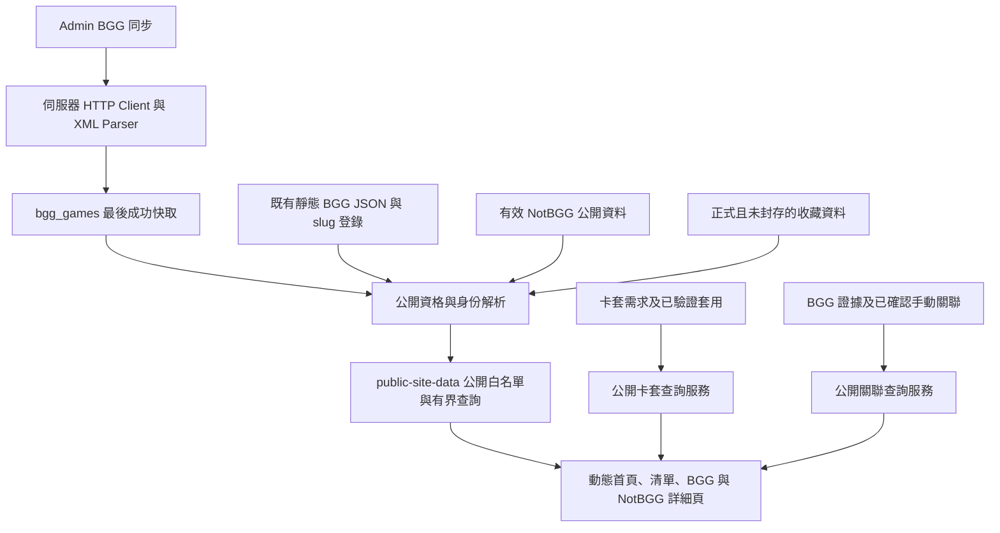

# 公開網站資料架構與後續規劃參考

> 2026-11-18退役規劃補註：使用者提出V1退役及V2表名去版本前綴，已完成正式核心資料唯讀對帳，見 [退役與命名評估](V1-retirement-and-table-normalization-assessment-20261118.md)。目前分類／清點／卡套仍依賴V1來源證據；本輪未改架構實作或資料表，本文下方既有表名仍是現況，不把命名提案當已部署。

更新日期：2026-11-12
架構基準：V2-P1-07 實作；正式部署及限定驗收狀態以後續 Release-03 紀錄為準，不能把架構描述解讀為所有正式操作均已驗收。

Release-01 完成隔離完整建置與 Worker 產物檢查，當時尚未操作正式環境；歷史準備結果見 [V2-Release-01 摘要](V2-Release-01-summary.md)，最新部署結果見下方 Release-03 更新。

本文件保存已實作的資料邊界、路由與規劃依據。後續規劃先核對本文及實際程式；若架構改變，應同步更新本文，不把本機成果推定為正式環境現況。

正式狀態更新（2026-11-12）：Release-03 已將 version 19 部署至指定正式 Worker，Migration 0001～0022 已套用；限定公開 HTTP 與使用者管理員唯讀驗收通過。架構基準仍為 V2-P1-07，完整正式證據與未實測項目見 [Release-03 摘要](V2-Release-03-summary.md)第 10 節。不得將此解讀為所有正式寫入流程已驗收。

## 1. 系統與資料流

- Astro + Cloudflare Adapter／Workers + D1 SQLite，沿用現有網站與 Admin 架構。
- Astro 設定仍為 `output: 'static'`；需要即時資料的公開路由個別設定 `prerender=false`。
- 公開頁不直接呼叫 BGG API，也不負責建立收藏、副本、採購、組件或庫存交易。

## 2. 資料來源優先順序

1. 優先使用 `bgg_games` 中 `last_success_at` 非空且有 `cache_json` 的最後成功資料。
2. 同步失敗時，保留並繼續使用上次成功內容；不能只依目前 `sync_status` 判斷內容是否可用。
3. D1 查詢成功、但沒有可用的新快取時，可使用既有公開靜態登錄與完整 JSON 詳細資料。
4. D1 查詢失敗或資料無法可靠解析時，明確顯示服務錯誤；不得假裝沒有資料、回傳錯誤的 404，或悄悄將靜態資料當作最新 D1 結果。
5. NotBGG 沿用有效原始公開資料及已確認身份對應，不把待確認身份當成已合併。

公開 API 與 Release-03 已驗證的動態詳細頁採 `Cache-Control: no-store`；首頁及清單 HTML 的正式回應未帶此標頭，不可宣稱所有公開 HTML 已設 no-store。程式沒有另設 D1 結果的 TTL 快取，成功同步提交後的資料查詢可讀到新內容，不需重建整站；瀏覽器／HTTP 快取行為仍需依各路由的實際標頭判斷。靜態登錄是相容性基線，不會由公開請求自動回寫。

## 3. 公開資格與身份

- 既有具備 BGG 詳細資料的靜態登錄維持公開；遊戲目錄不等同「已擁有遊戲」。
- 新增 D1 BGG 遊戲須有成功快取，且符合下列至少一項：
  - 連到 `record_scope='production'`、未封存且相關 NotBGG 未封存的收藏紀錄。
  - 連到有效、已確認的公開 NotBGG 身份對應。
- 只有同步快取、測試收藏或已封存收藏，不足以讓新的 BGG 遊戲自動公開。
- 有效 NotBGG 原始資料沿用既有公開政策；不是所有 NotBGG 項目都必須已收藏。
- `status='linked'` 的身份對應依 `primary_source` 決定公開主身份與去重；pending 不會搶占路由或合併資料。
- 收藏紀錄、遊戲身份與副本是不同層級，不可因同 BGG ID 就把多筆收藏紀錄去重。

## 4. 路由與狀態碼

| 用途 | 中文 | 英文 |
| --- | --- | --- |
| 首頁 | `/` | `/en` |
| 遊戲清單 | `/games` | `/en/games` |
| 收藏清單 | `/collection` | `/en/collection` |
| 既有 BGG 詳細頁 | `/games/[slug]` | `/en/games/[slug]` |
| 新增 BGG 詳細頁 | `/games/bgg/[id]` | `/en/games/bgg/[id]` |
| NotBGG 詳細頁 | `/games/notbgg/[id]` | `/en/games/notbgg/[id]` |

- 新 BGG 遊戲使用數字 ID 命名空間，避免同名遊戲及 BGG／NotBGG 路由衝突。
- 既有 slug 保留；支援的 `.html`、`index.html`、數字別名依正規化服務導向 canonical。
- Worker 只處理網址相容性正規化，再交給 Astro Handler；不再以靜態資產重寫 BGG 詳細頁內容。
- 身份及 canonical 重新導向在路由層回傳 HTTP 307，不能只在子元件中回傳重新導向。
- 不存在或不具公開資格的有效 ID 回傳 404；資料服務失敗回傳 503。

## 5. 有界查詢與清單操作

- `public-site-data.ts` 統一首頁概況、清單、BGG 詳細資料、路由決策與公開 BGG 身份索引。
- 清單在伺服器端搜尋、篩選與排序，每頁最多 20 筆，頁碼上限 1000。
- 支援來源、類型、收藏／願望清單／預購、玩家人數、遊戲時間、複雜度、機制及配件分類。
- 支援名稱、年份、BGG 評分與複雜度排序，以及部分舊排序參數相容。
- 卡片／清單檢視、查詢參數、語言切換及詳細頁返回清單保留合理狀態。
- 不再將完整收藏及整份目錄 payload 傳給瀏覽器；首頁概況以 SQL 聚合取得，不載入全部收藏列。
- CTE 使用 `AS MATERIALIZED`，避免靜態 JSON 登錄被反覆展開；已在隔離 D1 相容 SQLite 驗證。
- 公開 BGG 身份索引上限 20,000；關聯服務對相關資料設限，超限顯示不可用，不把截斷資料當作完整結果。
- 分類器必要的全域安全證據及原有 10,000 列 Fail Closed 規則不因公開清單最佳化而縮小或放寬。

## 6. 公開資料政策

允許顯示既有政策中的遊戲基本資料、BGG 評分與排名、收藏狀態、願望清單、預購、語言／版本、副本數量、卡套需求及可靠的實際套用產品。

不得新增公開：個人評分、採購價格／訂單／交易、私人庫存、私人備註、組合備註、操作紀錄、管理員身份、BGG Token 或組件簽章。個人評分沿用既有公開邊界，不因新資料來源整合擴大公開範圍。

- 公開 DTO 採白名單投影；不得直接序列化資料表整列或未篩選的快取物件。
- BGG 評分與個人評分分開；NotBGG 沒有 BGG 評分時不捏造數字。
- 收藏紀錄筆數不是遊戲款數、副本數或實體零件總數。
- 卡套需求張數不是庫存；同尺寸參考產品不是實際使用產品。
- 實際套用產品須有可靠紀錄，且 card 組件資格通過既有分類驗證；UNKNOWN 與歷史商品不可視為已確認實體卡牌。
- 遊戲關聯不代表已收藏；BGG 證據、已確認手動關聯及方向待確認資訊須區分。
- 管理入口沿用既有 Access 驗證；公開頁不另建第二套身分驗證。

## 7. UI、SEO 與索引

- 公開頁共用 Header／Layout、卡片、篩選與分頁樣式；沿用既有風格，不重設 Admin。
- 圖片缺失、空資料、查詢錯誤、重試及手機選單有明確狀態。
- 詳細頁整合收藏、卡套及關聯區塊，不再並列容易過期的建置時關聯區塊。
- Title、Description、Open Graph、canonical 與錯誤頁 noindex 由公開頁／Layout 處理。
- 動態 `/sitemap.xml` 索引及分頁 sitemap 只列公開 canonical 頁面；不列 Admin、API 或私人資料。
- `robots.txt` 指向 sitemap 並限制 Admin／API 爬取；此設定不取代伺服器端授權。

## 8. 主要實作入口

| 職責 | 檔案 |
| --- | --- |
| 公開主資料與資格 | `src/lib/public-site-data.ts` |
| 網址相容性 | `src/lib/public-route-normalization.ts`、`src/worker.ts` |
| 卡套／收藏公開投影 | `src/lib/public-game-collection.ts` |
| 公開關聯 | `src/lib/public-live-relations.ts` |
| 身份對應 | `src/lib/identity-resolution.ts`、`src/lib/notbgg-public.ts` |
| 同步／完整 Parser | `src/lib/bgg-sync-admin.ts`、`src/lib/bgg.ts`、`src/lib/bgg-parser.ts` |
| 公開頁共用元件 | `src/components/PublicHome.astro`、`PublicBrowse.astro`、`PublicBggPage.astro`、`PublicNotBggPage.astro` |
| 公開樣式／互動 | `src/styles/public-ui.css`、`src/lib/public-ui-controller.ts` |
| SEO／索引 | `src/layouts/Layout.astro`、`src/lib/public-sitemap.ts`、`src/pages/robots.txt.ts` |

## 9. 驗證基準與 Release 待辦

V2-P1-07 本機驗收紀錄：相關測試 57 PASS、0 FAIL；範圍限定型別檢查 0 errors／warnings／hints；Edge 中英文五種寬度共 50 組排版檢查通過，另完成搜尋、篩選、返回、同步更新與錯誤重試操作。

主要可重用測試：

- `tests/public-site-data.test.ts`
- `tests/public-site-sqlite-runtime.test.ts`
- `tests/public-site-browser.mjs`
- `tests/helpers/public-site-preview.ts`
- 相關卡套、同步與關聯回歸測試。

這些結果僅代表當時本機合成資料與 Mock 驗證，不是往後修改後的保證。規劃變更時執行必要的相關測試，不重跑無關的全部歷史審查。

Release 階段仍須核對正式綁定、既有 Migration 版本、Access、完整 Cloudflare 建置與動態路由／資產 manifest、快取規則、部署後 SEO 及正式環境驗收。既有 `npm run build` 的 `prebuild` 包含 `npx wrangler types`，不能當成不啟動 Wrangler 的隔離檢查。

V2-P1-07 未新增或修改 Migration，也未執行 Wrangler、正式／Preview D1 查詢、真實 BGG API 呼叫、正式 Migration 或部署。後續執行這些操作前，應依當次使用者授權與限制判斷；本文不是正式環境操作授權。
